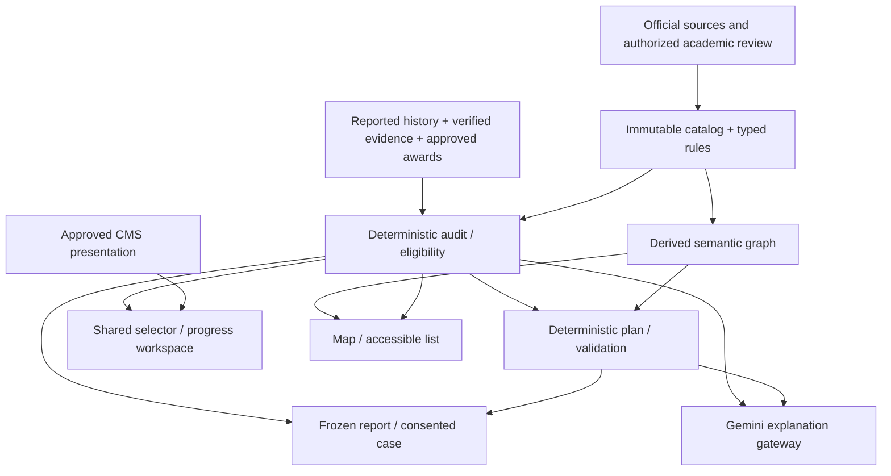

# Academic engine boundaries and canonical ownership

Phase 01C proposed architecture refinement for owner review. Builds on
[ARCHITECTURE.md](ARCHITECTURE.md), [DATA_MODEL.md](DATA_MODEL.md),
[AI_STRATEGY.md](AI_STRATEGY.md), [SECURITY.md](SECURITY.md), and
[ACCESS_CONTROL.md](ACCESS_CONTROL.md). This document defines contracts, not code,
new endpoints, migrations or permission to implement later phases.

## Problem evidenced by V1

V1 already shares prerequisite/allocation helpers between its selector and planner,
and keeps the deterministic plan when AI fails. Preserve that intent. But the transfer
page evaluates applicability independently, the map applies academic-looking edge
overrides absent from course payloads, and browser storage copies carry partial
course/report state. Corequisite notes and writing-intensive flags are not one
canonical verified rule model. [ALLOC] [PLAN] [TRANSFER] [GRAPH] [LOAD] [STATE]

V2 must have **one approved academic model and one deterministic evaluation core**.
It should not literally use one flattened visual graph for every calculation: typed
rules and evidence are richer than display edges. The shared canonical academic
graph is a versioned semantic projection of the catalog AST; audit, planner and map
consume that same model with operation-specific projections. Visualization/layout
cannot create or redefine academic truth.

## Domain ownership

| Domain / module | Canonical ownership | May consume / produce | Prohibited responsibility |
| --- | --- | --- | --- |
| Catalog and provenance | Immutable releases, Program/Course versions, typed requirements and eligibility expressions, source sections | Reviewed publication; derived semantic graph | Student completion, arbitrary CMS policy, unreviewed live graph overrides |
| Academic history | Original Course/ExamAttempt, grade/term/institution, reported/verified status, source evidence | RecordRevision; approved Award/Exception linkage | Inferring institutional credit from a code match or model confidence |
| Audit / eligibility engine | Versioned evaluation semantics and global credit allocations | Reproducible AuditRun with results, explanations and residual requirements | UI state, model prose, rendering layout or provider availability |
| Planning | Term candidates, workload/availability constraints, hypothetical allocations and PlanRevision | Feasible/partial/infeasible/unknown outcome and canonical revalidation | Marking planned credit earned or certifying registration/graduation |
| Transfer / exam evaluation | Directional conditional mappings and authorized student-specific awards | Tentative comparisons or approved destination inputs for audit | Separate independent degree-credit calculator |
| Selector / progress workspace | Presentation, draft user edits and revision synchronization | Mutations through history service; display canonical audit | Local course-code truth or per-component eligibility formulas |
| Graph visualization / layout | Nonacademic expansion, viewport, focus and layout preferences | Catalog graph + audit overlay, accessible list and print projection | Using edge dragging/layout order to change requirements |
| AI Gateway | Bounded language interpretation and explanation, approved model/prompt versions, cost ledger | Minimal authorized source/result snapshots; validated action proposals | Academic calculations, approval grants, invented equivalencies, arbitrary mutation |
| Reports and advisor cases | Immutable payload snapshot, selected evidence, authorized consent/assignment and case state | Consistent HTML/text/PDF and reviewed handoff | Dropping partial-plan warnings or silently refreshing old academic claims |
| CMS | Approved editorial blocks, message templates, page composition/campus overrides | Display references to approved facts, protected warnings | Rule thresholds, credit arithmetic, permission checks or consent on user's behalf |
| Governance | Scoped delegated grants, verified authority, exact-revision approval/publication/audit | Academic/editorial review and immutable release publication | Treating Super Admin as default academic authority |

Keep this as modules within FastAPI's modular monolith and the Next.js workspace,
not distributed microservices by default. Future SQLAlchemy/Alembic persistence
stays exclusively in `cuny_advisor_v2`; do not reuse V1 runtime/schema or credentials.

Arrows are data dependencies, not permission grants. Report and AI access remain
workspace/actor/campus scoped even when catalog sources are public.

## Canonical context and result identity

Every operation binds campus, program version, catalog release/assignment revision,
workspace, profile revision, record revision, approved exceptions/award versions,
engine version and audit mode. Derived graph has a schema version and source hash.
Persist durable immutable inputs or snapshots plus hashes, not hashes alone. None
of these IDs is a bearer permission. Backend derives actor/grants and rechecks expiry
and consent for every fetch, job, stream and download.

Return an explicit result ID plus input revision tuple. The selector, graph, planner,
comparison, report and AI do not substitute different catalog versions. A hypothetical
major/transfer context has its own context/result IDs and never mutates declared
context implicitly. Published release withdrawal blocks new use and marks current
plans stale; historical replay remains attributable subject to approved retention.

## Distinguish academic states

Do not collapse these dimensions into V1's completed/available/locked/not_needed:

- **Evidence:** student-reported, imported/unreviewed, verified against evidence,
  institutionally awarded, disputed, revoked. Student confirmation is a separate event.
- **Academic record:** original attempt, passed/failed/in-progress/withdrawn, grade,
  credits and repeats; retain all attempts and source institution/term.
- **Requirement result:** met, unmet, conditional, unresolved; with allocation IDs
  and reasons. A course can be eligible but unnecessary for the chosen degree path.
- **Plan item:** candidate, validated concrete course, unassigned requirement slot,
  tentative offering, selected section. Neither a placeholder nor future pass is earned.
- **Offering evidence:** unknown, source-confirmed at timestamp, stale, or unavailable.
  Catalog listing and a model-generated suggestion never establish a seat.

Transfer and AP/IB/CPL evidence must produce a reviewed mapping/case before an
institutional award is modeled. Comparison may simulate tentative credit with clear
hypothetical labels, never overwrite the student's original history.

## Rule and graph semantics

Represent AND, OR, choose-N, credit/count thresholds, grades, standing, residency,
repeat/overlap policies and approved scoped exceptions through a typed versioned
rule AST. Each assertion links to a source section, effective period and verified
approval. Implement only a supported, validated subset at a time. Unsupported
operators or missing applicability yield unresolved results, not an empty prerequisite.

Project course, requirement, option-set and condition nodes with distinct edge types:
prerequisite, co-requisite, recommended sequence, satisfies/eligible-for requirement,
and option membership. Include rule and source IDs on derived relations. A simple
course-course DAG cannot fully express all eligibility/degree conditions.

Use strongly connected component analysis for necessary-dependency cycle diagnosis;
separate nodes merely blocked downstream from actual cycle members. Analyze OR
branches before declaring a catalog impossible; an alternative can break a cycle.
Same-term co-requisite bundles are legal only when the reviewed rule says so and
must be scheduled/validated together. Recommended sequence edges are preferences,
not eligibility constraints. Layout-engine cycle handling cannot validate academics.

The map and planner **share this canonical semantic graph**, but neither duplicates
the rule evaluator. Planner candidates and manual moves call the engine. The map's
completion overlay and requirement groups render the same AuditRun allocations as
progress; hiding a branch changes only visible UI, never credited work.

## Requirement slots, courses and offerings

Replace fake Course rows such as V1 elective/Pathways placeholders with typed
requirement slots: eligible pool/expression, remaining credits/count and unresolved
selection state. A plan can reserve credit capacity for a slot while stating that a
concrete approved course must still be chosen. Such credit is prospective capacity,
not validated completion or guaranteed applicability.

Selecting a concrete course validates pool membership, prerequisites/corequisites,
overlap, timing and load, then creates a plan revision. Offering/section evidence
is optional and freshness-scoped; lack of it cannot be hidden by a confident plan.
Keep registered sections, if ever authorized, outside the advisory plan commitment.

## Global allocation and deterministic planning

Audit normalizes repeats/grades/awards under the selected release, then allocates
eligible earned credit globally to requirements under explicit overlap rules and
stable tie-breaking. Preserve allocation explanations and unmet residuals. Do not
independently sum every course candidate or greedily spend a course based on which
category happens to render first. Distinguish earned, projected and hypothetical
modes and never count the same original and awarded credit twice.

Planning starts from the audit's residual requirements and searches validated
candidates subject to hard versus soft constraints. Record bounded search outcome
separately from feasibility: timed-out/incomplete search is not proof no plan exists.
Algorithm/solver choice remains open pending fixtures and scale measurements.
Every returned plan is revalidated by the canonical engine. No AI call is required.

For a partial result retain planned courses, prospective slot capacities, residual
requirement IDs/credits, blocker codes, source evidence, feasibility status and
suggested user-controlled revisions. `placedCredits` is not sufficient: compute a
residual audit from the hypothetical plan to detect overlap and missing conditions.
The synthetic 50-required/46-placed fixture must expose four remaining credits in
all views, reports and handoffs. If numbers reconcile but conditions fail, the plan
still cannot be marked complete.

## Proposed API contracts (future, not endpoints implemented here)

All below are `/api/v1` recommendations subject to contract review. Request scope
includes context/revision; actor/access are server-derived. Writes use optimistic
revision checks and scoped idempotency keys, returning new revision/result IDs.

| Operation | Proposed route family | Minimum response / behavior |
| --- | --- | --- |
| Read active context | `GET /workspaces/{id}/context` | Scope, catalog assignment, current profile/record revisions and permission-safe capabilities |
| Review/edit history | `GET/POST /workspaces/{id}/academic-record-revisions` | Original attempts, evidence/verification state, validation issues; no raw completion-code toggle authority |
| Read catalog/pools | `GET /catalog-releases/{id}/requirements` and `/course-pools/{id}` | Typed requirements, stable IDs, sources, paging and eligible course identities |
| Run audit | `POST /workspaces/{id}/audits` | Frozen inputs, engine version, mode, allocations, met/unmet/conditional/unresolved, residual IDs/reasons |
| Read graph | `GET /catalog-releases/{id}/academic-graph` | Versioned semantic projection; student overlay requested separately under workspace authorization |
| Build/validate plan | `POST /workspaces/{id}/plans`, `POST /plans/{id}/validations` | Concrete/slot items, constraints, outcome/search status, residual audit, unplaced reasons, offering evidence and stale state |
| Compare context | `POST /workspaces/{id}/comparisons` | Explicit hypothetical destination/release, conditional mapping decisions and canonical audit results |
| Explain result | `POST /explanations` | Authorized audit/plan IDs, grounded commentary or safe unavailable status; no client-authored academic totals |
| Prepare report / handoff | `POST /workspaces/{id}/reports`, `/reports/{id}/handoff-proposals` | Frozen academic facts, residuals, display version and selected payload/recipient/purpose/retention before explicit consent |
| Academic proposal / visual layout | Separate `/academic-change-proposals` and `/graph-layout-preferences` | Independent permissions and lifecycles; no direct live rule update from a drag event |

Long work may return an authorized job ID; polling/streaming checks active scope and
expiry. Errors carry stable codes such as stale_revision, unsupported_rule,
missing_evidence, invalid_catalog_context and incomplete_plan with safe descriptions.
No raw model/provider error, hidden academic fallback, SQL detail or credential.

## Synchronization across tools

1. User confirms reported-history/profile change through one workspace action.
2. Backend validates scope and expected revision, persists a new revision atomically,
   and marks dependent audits/plans/reports-for-new-use stale.
3. One shared frontend context invalidates affected query keys. Read-only rendering
   preferences (pan/expand/focus) stay independent of academic state.
4. Fetch a canonical AuditRun, then use its ID for selector/progress/map overlays and
   plan validation. If a result returns for an old revision, label it historical or
   discard it from current view; never mix it with fresh totals.
5. Display pending synchronization/stale state explicitly. If refresh fails, keep the
   last supported result with its version/date instead of calculating locally.
6. Historical reports remain frozen; a newly generated report is another snapshot.
   An academic publication similarly triggers affected-context review and new runs.

An event log or polling strategy can support invalidation, but no event infrastructure
is mandated now. A future client cache library is an implementation choice. Browser
storage may cache non-authoritative preferences within retention rules; it is not a
substitute for server ownership or a mechanism to extend guest TTL.

## AI and CMS boundaries

The Gemini Gateway explains exact authorized deterministic snapshots and sources.
Interpretation may propose missing profile/course fields, but student confirmation
and academic evaluation stay separate. Validate material claims/status/totals against
result IDs; reject invented sources or mutations. On outage/budget exhaustion the
structured audit/plan/report remains usable with template explanations. Do not
send the entire client page or raw transcript by default. Apply existing privacy,
spend, retention and consent rules equally to guests and registered users.

CMS owns copy keys/templates/approved layout blocks and campus overrides. It may
format a requirement explanation with facts supplied by the engine, never edit a
threshold or remove protected uncertainty/consent/institutional notices. Academic
publication requires a separate verified approval workflow; faculty-contributed
syllabus/section material remains a separate labeled provenance layer. Super Admin
access cannot independently establish academic authority.

## Performance, exports and acceptance gates

Cache immutable public catalog/graph projections by release/schema/content hash;
private overlays by workspace, permission and record/audit revision. Batch related
catalog queries instead of V1's per-node/per-edge ORM lookups. Lazy-load graph UI,
collapse nonessential branches, memoize visible nodes/adjacency and run expensive
layout off the main thread if the benchmark justifies that engine. Cancel stale
layout work and keep layout/version cache independent from academic result state.

Proposed benchmark fixtures: 100, 500 and 1,000 nodes with grouped requirements,
optional paths, co-requisite bundles and shared dependencies, on desktop and a
representative mobile device. Initial targets for owner review: visible interaction
p95 under 100ms and initial useful graph under 2s for the 500-node fixture on agreed
hardware. These are unmeasured proposals, not guarantees. Measure bundle/network,
layout time, long tasks, memory, focus continuity and reduced-motion behavior.
Keep an accessible list when graph limits are exceeded.

Generate print/PDF from a frozen report/graph projection, not screenshots of arbitrary
collapsed DOM state. Define current-view versus full-graph coverage, deterministic
pagination, legend and version/source attribution. Do not infer a library provides
production-quality exports or compliance without testing.

Acceptance requires consistent allocations, status and residual reasons across all
modules, no AI dependency for deterministic operations, approved source/version
lineage, scoped access including guest expiry, complex-rule fixtures and report
parity. [V1_TO_V2_MIGRATION.md](V1_TO_V2_MIGRATION.md) supplies the regression matrix.
All implementation, graph-library selection and data migration await owner review.

[ALLOC]: https://github.com/dmitrivanov/academic-advisement-system/blob/ba499bc078a4889ed7ed4ad2f381a5c6950753d3/frontend/db_progress_graph.html#L2727-L3032

[PLAN]: https://github.com/dmitrivanov/academic-advisement-system/blob/ba499bc078a4889ed7ed4ad2f381a5c6950753d3/frontend/db_progress_graph.html#L4035-L4310

[TRANSFER]: https://github.com/dmitrivanov/academic-advisement-system/blob/ba499bc078a4889ed7ed4ad2f381a5c6950753d3/frontend/transfer_analysis.html#L636-L840

[GRAPH]: https://github.com/dmitrivanov/academic-advisement-system/blob/ba499bc078a4889ed7ed4ad2f381a5c6950753d3/curriculum_graph_service.py#L47-L282

[LOAD]: https://github.com/dmitrivanov/academic-advisement-system/blob/ba499bc078a4889ed7ed4ad2f381a5c6950753d3/api_db_routes.py#L1775-L1931

[STATE]: https://github.com/dmitrivanov/academic-advisement-system/blob/ba499bc078a4889ed7ed4ad2f381a5c6950753d3/frontend/db_progress_graph.html#L4313-L4445
