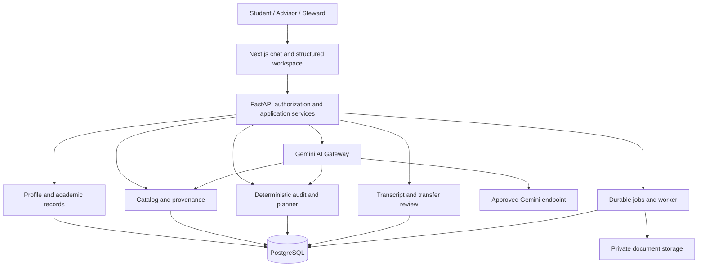

# Architecture

Status: target architecture with bounded local implementation, 2026-10-17.
The skeleton, design system, bounded Phase 02A/02B prototypes and Phase 02C local
persistence adapter and bounded Phase 02D workspace plus Phase 03A frontend refinement are implemented; broader
services below remain targets.
Phase 03B campus/profile foundation, merged Phase 04A optional gateway and the local
Phase 04B institutional registry are also implemented. See current slice below.
Evidence classifications and external sources: [PRD](PRD.md).

## Current Phase 02A implementation boundary

`backend/app/academic/` contains immutable typed catalog/provenance/rule contracts,
pure in-memory evaluation and read-only four-column/condition projections. Existing
Pydantic is reused. A manually curated BMCC CS 2026–2027 draft and separate synthetic
fixtures establish regressions without exposing a new API. Allocation proposals
are globally validated; automatic allocation search, publication, persistence and
full-degree auditing are not implemented. No frontend calculations or health
contract changed. See [rules model](ACADEMIC_RULES_MODEL.md),
[sources](BMCC_CATALOG_SOURCE_MAPPING.md) and [parity](V1_SELECTOR_PARITY.md).
The remaining architecture below is a target, not a claim of delivered services.

Phase 02B adds scoped evidence/conflict validation, non-credit claims with no award
semantics, shared category vocabulary, a second partial program and immutable old
versus new-engine snapshot tests. All remain in memory with no new endpoints or
frontend behavior. [Phase 02C persistence](PERSISTENCE_DESIGN_PHASE_02C.md) is an
implemented local draft adapter; the source and policy gaps remain explicit in the
[evidence matrix](ACADEMIC_POLICY_EVIDENCE.md).

## Implemented Phase 02C persistence boundary

SQLAlchemy Core tables and `CatalogRepository` under `backend/app/persistence/`
retain exact validated DTO JSONB plus normalized, hash-checked scoped projections.
The repository loads complete Pydantic releases before invoking the unchanged pure
evaluator. Campus edition/revision and program release bindings remain distinct.
No ORM/session enters the academic contracts. All 16 tables and Alembic tracking
use `cuny_advisor_v2`. Explicit local bootstrap, separate migration/runtime roles,
append-only writes and manual migrations/imports operate only on disposable V2
resources. The API/health/frontend do not connect to PostgreSQL. This is neither
academic publication nor a student database. Local DB checks could not run without
Docker/PostgreSQL; real integration tests run in the separate CI service job.
See [implemented design, tradeoffs and checklist](PERSISTENCE_DESIGN_PHASE_02C.md).

## Implemented Phase 02D workspace boundary

The Next.js campus conversation (`/campus/bmcc` since Phase 03B, formerly `/`)
is a minimal conversation-only home with a typed module registry,
exact local navigation router and one session-local academic reducer. Structured
chat actions or deep links open focused catalog/selector/limited progress views.
Chat remains mounted but hidden while using a tool; the return action restores
focus and retains conversation/input/selection state. No persistent module menu
or dashboard is rendered. Future deep links remain explicitly unavailable.

Phase 03A is a frontend-only presentation refinement. A pure presentation helper
reorders a copy of the canonical four columns for V1 visual hierarchy; backend
projection order and all academic interpretations remain unchanged. Class details
render captured rule structure without evaluating eligibility. Provenance and
unresolved conditions remain available through disclosures. Source verification
is not approval. No backend, migration, fixture, schema, provider or dependency
changes. See [UX workflows](UX_WORKFLOWS.md) and [verification](PHASE_03A_VERIFICATION.md).

FastAPI adds scoped read-only catalog discovery/content plus hypothetical evaluation
through explicit repository dependency injection. The browser uses a bounded local
Next.js proxy and typed client. PostgreSQL is the sole runtime catalog source; no
frontend fixture arrays, in-memory service fallback, startup seed or new migration.
Complete releases load once per scoped request before pure evaluation. The shared
context is frontend tab memory, never mutable per-user backend globals or DB rows.

The service projects requirement AST membership for the four columns but does not
reimplement satisfaction, allocation or prerequisites. The hypothetical adapter
leaves grades unknown and refuses to invent missing course credits. It does not
persist requests/results. [API](WORKSPACE_API.md) and [UX](UX_WORKFLOWS.md) document
contracts, context lifecycle, current versus future modules and uncertainty.

At the Phase 02D/03A baseline Gemini remained future work. The bounded Phase 04A
local gateway is now described below; the full Phase 04 strategy remains future. Playwright is a pinned
**development-only** test dependency for mocked-API browser flows/responsiveness;
no runtime UI framework is added. Existing npm advisories remain technical debt.

## System boundaries

Use a modular monolith: one Next.js frontend and one FastAPI backend with shared
PostgreSQL persistence through SQLAlchemy. Alembic owns schema migrations. TypeScript and Tailwind
support the frontend. A backend worker executes longer imports and reports using
a durable PostgreSQL job table initially; a separate broker is a future decision
supported by measured queue load. Private object storage is proposed for uploaded
documents and exports; vendor selection is open.

Gemini never connects directly to persistence, storage, identity, or external
college systems. Gateway tool calls pass through the same application-level
authorization and validation as direct UI requests.

## Domain responsibilities

| Module | Owns | Must not own |
| --- | --- | --- |
| Identity/access | Sessions, campus membership, student/advisor grants | Academic truth or prompt-defined permissions |
| Profile/records | Confirmed preferences, attempts, evidence revisions | Automatic transfer awards |
| Catalog | Releases, sources, reviewed rule definitions | Mutable published requirements |
| Academic engine | Eligibility, credit allocation, audit explanations | LLM-dependent calculations |
| Planning | Feasible candidates, constraint checks, draft revisions | Guaranteed seats or registration |
| Transcript/transfer | Extraction review, equivalencies, evaluation cases | Unreviewed credit admission |
| Advising/reporting | Conversations, action proposals, evidence snapshots | Unrestricted advisor access |
| AI Gateway | Retrieval, structured interpretation, model policy, costs | Rules, identity decisions, arbitrary execution |

## Request and state contracts

FastAPI is the authoritative API and authorization boundary. Next.js handles
presentation and session transport; do not duplicate rule logic in server actions
or browser components. Choose supported framework versions and identity library
in the first authorized implementation phase.

Proposed versioned API groups: profiles, academic-records, catalogs, audits,
plans, transcript-imports, transfer-cases, reports, and conversations. Use typed
request/response contracts and generated TypeScript clients from reviewed OpenAPI.
Errors carry a stable code, safe message, correlation ID, and actionable missing
inputs; never return raw model prompts, stack traces, or storage credentials.

Mutations require authenticated intent, validation, and expected revision numbers.
Conflicts return a refresh/review response. Audit/report/import creation accepts
idempotency keys scoped to actor and operation. Long work returns a job ID with
authorized status polling and cancellation; no synchronous model call holds a
database transaction. Streaming uses an authorized endpoint, bounded events,
cancellation, and final validation before publishing an academic answer.

## Academic processing

1. Resolve the student's confirmed campus, program, and approved catalog assignment.
   Missing or disputed applicability triggers clarification, not latest-year default.
2. Freeze a record revision, profile revision, rule release, approved exceptions,
   and engine version in an immutable audit request.
3. Normalize repeated attempts, grades, transfer awards, and equivalence groups
   using published policies. Preserve original values and reasons for exclusion.
4. Evaluate a declarative rule tree and globally allocate course credits across
   requirements. Enforce overlap policy and deterministic tie-breaking rather
   than greedy allocation. Record rule-level evidence and unresolved dependencies.
5. Plan against the result using hard academic constraints and soft preferences;
   return feasible alternatives or an explanation of incompatible constraints.
6. Persist the result and input hashes; let Gemini explain only the validated output.

Completed, projected, and hypothetical audits are separate modes. In-progress or
planned credit cannot satisfy an earned-credit result. No known rule is not proof
of eligibility. A changed source, record, or exception marks dependent outputs
stale; recomputation creates new snapshots rather than rewriting old evidence.

## Catalog pipeline

Capture official sources with URL, section, effective period, retrieval time, and
content hash. Extraction produces a draft, never live rules. A steward reconciles
requirements; a distinct reviewer signs off on source evidence, policy semantics,
fixture changes, and release diff. Publish atomically after validation. Withdraw
an invalid release from new use while retaining it for historical replay and
notifying affected users. Never silently migrate catalog assignments.

An official-source disagreement becomes a tracked issue with affected rules
disabled or unresolved until the designated academic authority resolves it.
Retrieval indexes are derived, release-scoped artifacts; they cannot publish rules.

## Security and privacy design

Use email/password initially with verified email, secure password hashing and
reset flows; add approved OIDC/SSO later. Use secure HTTP-only sessions, CSRF
protection for cookie-authenticated changes, narrowly allowed origins, and verified
backend identity. Do not store browser credentials or Gemini keys client-side.
Student ownership, active advisor assignment, campus scope, and action permission
must all be checked server-side. PostgreSQL row-level security provides a second
boundary; request scope must be transaction-local under pooled connections.
Worker jobs receive explicit scoped actors and recheck access before publishing.

Keep privileged catalog publication separate from access to student records.
Use TLS, encryption at rest, managed secrets, access auditing, short-lived download
links issued after authorization, and least-privilege database/storage roles.
Reports and chat are private and must not enter public frontend caches or logs.

Treat uploads, retrieved sources, and model output as untrusted. Quarantine files,
validate type/size/pages, scan them, isolate parsing without network privileges,
sanitize rendering, and block arbitrary URL fetches and tool execution. Define
retention/deletion for transcripts, chat, exports, caches, and backups with the
institution before real data; no compliance claim is made by this plan.

## Operations and resilience

Use durable job leases, bounded retries, idempotent finalization, dead-letter state,
and reviewable recovery. Gateway timeouts and budget failure return deterministic
results with an explanation fallback. Report generation and imports must survive
worker restarts without duplicate awards or snapshots.

Collect redacted structured events, metrics, traces, correlation IDs, job failures,
catalog age, unresolved rules, model tokens, and costs. Do not record transcript
content or sensitive chat in ordinary telemetry. Alerts cover authorization
failures, stale releases, extraction errors, provider failures, and spend limits.

Future environments use synthetic local/test data and isolated staging. CI gates
cover contracts, academic fixtures, migrations, isolation, accessibility, and
dependency/security checks. Rehearse expand/contract Alembic changes and restore
from encrypted backups before rollout. Proposed recovery goals are RPO 24 hours
and RTO 8 hours, pending service-owner approval and a demonstrated restore drill.
Deployments, secrets, monitoring providers, and production access are future work.

## Second-prompt architecture refinements

Add identity/session, workspace lifecycle, delegated governance, consent/handoff,
and approved-block CMS modules within the FastAPI modular monolith. Next.js serves
English-only guest, student and administrative workspaces. Domain services accept
an authorized workspace principal, which may be a temporary guest or account user;
“authenticated” does not require registration for guest operations.

A Workspace owns profile/record revisions, plans, progress, conversations, uploads
and reports. Guests have a fixed `expires_at` of creation + 24h; registered workspaces
retain owner-bound save/resume. Every API, retrieval, stream, download and worker
checks current access and expiry. The lifecycle worker purges expired graphs and
storage derivatives with tombstones preventing late writes. Conversion atomically
claims selected data under verified account ownership and revokes the guest session.
See [security](SECURITY.md) for concurrency, storage finalization and deletion rules.

Consent/handoff stores an immutable payload-specific permission and target recipient.
Pending requests remain workspace-bound. Authorized acceptance before expiry can
create a minimal separately retained case snapshot under disclosed policy; it does
not transfer the whole workspace or raw transcript by default. No notification or
external delivery integration is authorized by this document.

Governance distinguishes role administration, academic review, editorial review
and publication. Scope includes college, department/program and section where
applicable. Delegated grants cannot expand authority. Catalog approval and CMS
publication bind exact immutable revisions. Faculty contributions have their own
provenance layer and cannot feed deterministic policy directly. See the full
[matrix and workflows](ACCESS_CONTROL.md) and [CMS design](CMS_DESIGN.md).

Future persistence is isolated in PostgreSQL schema `cuny_advisor_v2`, preferably
in a dedicated V2 database. SQLAlchemy metadata and Alembic version tables must
explicitly target that schema. Runtime roles cannot create schemas or access V1;
migration privileges are separate. Explicit schema qualification and constrained
search paths prevent accidental fallback to `public` or V1 tables. Schema naming
alone is not security isolation. No connection, schema or migration is created in
Phase 00. Synthetic Phase 01 checks must demonstrate isolation before any rollout.

## Implemented Phase 03B multi-campus frontend

`/` is the campus-selection constellation; the Phase 03A conversation moves to
`/campus/bmcc`. A typed display/capability registry is independent of catalogs.
Known future campus routes are unavailable; unknown slugs return not found. Legacy
root BMCC tool links migrate explicitly, preserving exact query/hash context.

A root in-memory provider holds a campus-neutral evidence-aware profile and advising
session across client navigation. A pure readiness/question layer derives relevant
missing facts by goal. Selection never infers enrollment, dates never assign catalogs,
reported course history never implies credit/eligibility, and all actual academic
evaluation remains in the unchanged backend. Optional future interpreter contracts
accept only proposals; no AI integration or generic executor is instantiated.

See [multi-campus architecture](MULTICAMPUS_ARCHITECTURE.md), [profile](STUDENT_PROFILE_MODEL.md),
[readiness](ADAPTIVE_ADVISING_READINESS.md) and [verification](PHASE_03B_VERIFICATION.md).
Existing backend, PostgreSQL schema/migrations, catalog fixtures and dependencies
are unchanged. No student persistence, real data, official approval or deployment.

## Implemented Phase 04A local conversation boundary

Backend-only google-genai adapter, strict proposal contracts, loopback-only bounded conversation API and same-origin proxy add opt-in fictional natural conversation. Existing Phase 03B profile/readiness and academic services remain authoritative. Every model profile/goal change requires confirmation and a matching state snapshot. Academic facts stay in sourced deterministic modules; no generated academic retrieval or database chat storage. No schema, fixture or evaluator changes.

See [Gemini gateway](GEMINI_GATEWAY.md), [orchestration](CONVERSATION_ORCHESTRATION.md) and [verification](PHASE_04A_VERIFICATION.md).

## Implemented Phase 04B institutional boundary

Five append-only public registry tables extend the existing isolated V2 schema
through `04b_001`; academic persistence and pure evaluation remain unchanged.
The migration-role importer validates reviewed source facts in one transaction,
reuses campus identities, and verifies a canonical digest on import and read.
Runtime has SELECT only on these new tables. Versioned source/revision references
are scoped by composite FKs; identity/support changes require reviewed migrations.

Typed read-only `/api/v1/institutions` and `/{slug}` routes feed a no-store Next.js
proxy, shared context and server-rendered campus routes. No source fetching or AI
is used at runtime. Only layout remains frontend-owned. BMCC is the only pilot;
source verification never grants academic authority. Other institutions have no
invented catalogs. Explicit error/empty states replace static metadata fallback.
See [registry contract and source mapping](INSTITUTIONAL_REGISTRY.md) and
[verification](PHASE_04B_VERIFICATION.md). The source scope is 26 as retrieved on
2026-10-17, not a permanently assumed CUNY total. Phase 04C remains proposed.

## Implemented Phase 04C-1 source-browsing boundary

`backend/app/catalog_ingestion/` owns public-source captures, typed staging, coverage
and bounded review artifacts, append-only browse snapshots and their integrity-checked
projections. Seven new tables under `cuny_advisor_v2` follow `04b_001` via `04c1_001`.
Canonical JSONB and exact Decimal strings follow existing persistence conventions;
composite FKs protect same-snapshot department relations. Runtime gets SELECT only.
No new dependency, implicit migration, startup network or academic release mutation.

The 2025–2026 Bulletin snapshot remains distinct from 2026–2027 audit releases.
Current website program identities and supporting rule text retain null year
applicability. No structured eligibility rule is newly promoted; typed representation
of additional condition kinds is browse evidence only and never enters the unchanged
pure evaluator. Full degree requirements belong to 04C-2.

Read-only `/api/v1/bmcc-catalog` discovery/resources and the loopback Next.js proxy
power an on-demand Academic Catalog browser. Exact snapshot selection, text search,
pagination, offering-unit filters and evidence disclosures cannot add unreviewed
courses to the existing selector/progress context. See [source mapping/schema/API](BMCC_CATALOG_INGESTION.md)
and [verification](PHASE_04C1_VERIFICATION.md). BMCC alone remains operational.
